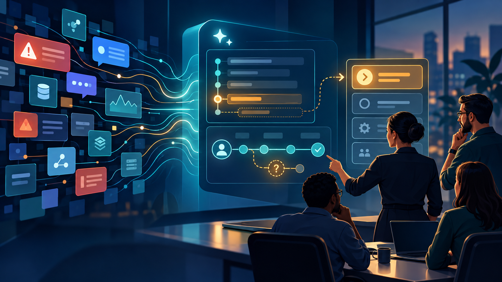

# The Evolved Incident Commander

**AI should help incident commanders see more clearly and act with better context. It should not take the command.**

I believe incident command is evolving beyond running a bridge, collecting updates, and following a process. Those fundamentals still matter, but today’s systems ask more of the incident commander: connect service signals to customer impact, make uncertainty visible, align teams around the evidence, and verify recovery.

I have been applying AI to the repetitive first pass—organizing updates, building timelines, surfacing gaps, and preparing drafts—so people can focus on judgment, coordination, and decisions. The human remains accountable for what happens next.

## Featured article

### The Evolved Incident Commander: Seeing Outages Through an AI Lens

An outage is a fast-moving decision environment. This article explores how AI can help an incident commander form a clearer operational picture, move from reporting activity to directing attention, and extend traditional ITIL foundations with evidence-led, customer-focused response.

[Read the full article](blog/evolved-incident-commander.md)

## The perspective

- **AI organizes; people command.** Use AI to synthesize authorized evidence and prepare a first pass. People validate, set direction, communicate, and approve action.
- **Customer impact comes first.** Explain what users cannot do before getting lost in component names.
- **Uncertainty stays visible.** Separate confirmed facts, reports, hypotheses, conflicts, and unknowns.
- **Recovery is verified.** A mitigation or one successful test does not prove every customer path is restored.
- **Measure the benefit.** Evaluate time to an evidence-backed briefing and the quality of human review instead of claiming unmeasured savings.

## A practical example

The article uses a fictional booking-service outage to show how an assistant can distinguish a completed rollback from verified recovery. The companion workflow and diagrams are provider-neutral and use synthetic evidence.

- [How the review flows end to end](docs/images/end-to-end-review.svg)
- [How the customer journey can be mapped](docs/images/service-flow.svg)
- [Scenarios and expected behavior](docs/scenarios.md)
- [Architecture and trust boundaries](docs/architecture.md)

---

*Written by Aman Kumar. A practical exploration of AI-enabled incident command, evidence-led operations, and human accountability.*
