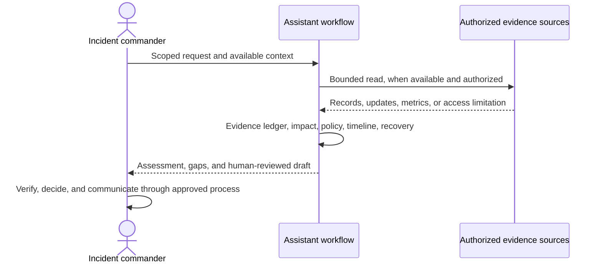

# Architecture and Design

## Components

1. **Scope resolver** — uses the incident and time range supplied by the user; asks for clarification only when necessary.
2. **Evidence ledger** — records claims with source, time, evidence type, and limitation.
3. **Impact assessor** — translates technical symptoms into user-visible effects and bounded figures.
4. **Policy-aware classifier** — evaluates urgency and impact against guidance supplied for the target organization; does not invent a universal priority matrix.
5. **Response tracker** — separates completed, ongoing, planned, and suggested actions, and distinguishes mitigation from verified recovery.
6. **Briefing composer** — produces the requested review or draft in plain language and labels communications for human review.
7. **Safety boundary** — keeps the assistant in analysis and drafting mode; the host platform remains responsible for technical permissions.

## Request flow

## Design choices

- **Evidence before narrative:** each conclusion must be traceable to evidence or labelled as uncertain.
- **Customer journey before component jargon:** explain the user-visible failure first.
- **Policy comes from the operator:** priority matrices and status formats vary by organization.
- **Recovery is scoped:** a mitigation, healthy metric, or one passing test does not establish recovery of every path.
- **Human owns action:** suggestions and drafts do not imply execution or approval.
- **Provider-neutral packaging:** this edition names no vendor connector or private endpoint. A deployment may add authorized integrations separately.

## Trust boundary

The instruction pack can guide model behavior but cannot sandbox it. Tool access, credentials, logging, and enforcement belong to the assistant host and its administrators. Only expose the minimum read permissions needed for the intended workflow.
