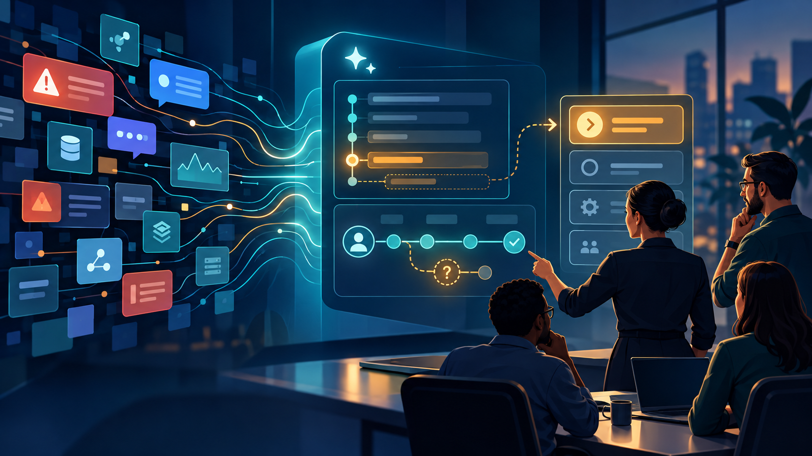
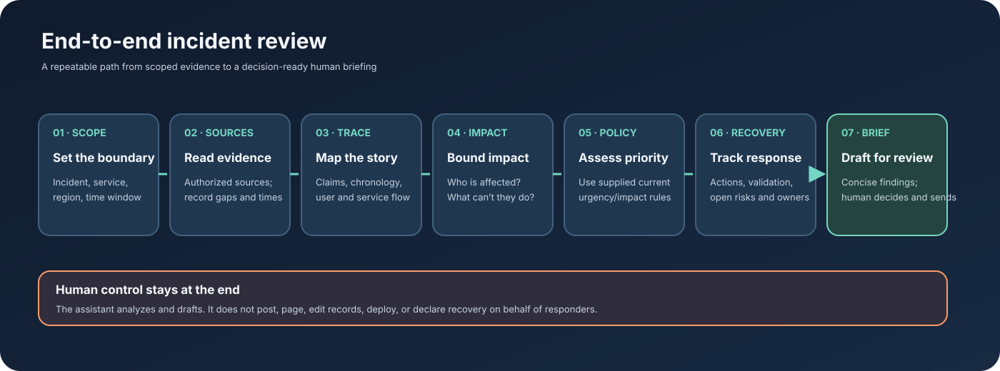
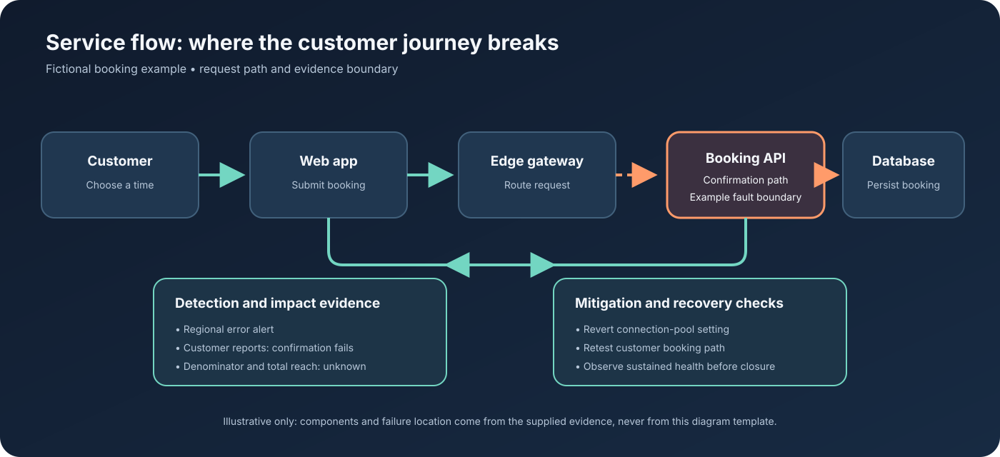

# The Evolved Incident Commander: Seeing Outages Through an AI Lens

*AI should help incident commanders see more clearly and act with better context. It should not take the command.*

An outage is more than a technical failure. It is a fast-moving decision environment: signals change, customer impact develops, dependencies behave in unexpected ways, and teams need a shared understanding of what is happening.

The incident commander has to make that picture useful while the picture is still changing.

For a long time, incident command has been associated with running the bridge, maintaining the action log, sending updates, and following an established process. Those responsibilities still matter. But modern systems demand more than coordination and process completion. The incident commander has to understand the customer journey, connect evidence across teams, separate certainty from assumption, and help the organization choose the next best action.

That is where I see AI changing the work.

## From process completion to decision quality

Frameworks such as ITIL provide a valuable operating foundation. They help teams speak the same language and respond consistently. I see AI as a way to build on that foundation: use automation to reduce repetitive synthesis, then spend more human attention on impact, judgment, coordination, and verified recovery.

The shift I am working toward is simple: less time copying updates into a new format; more time asking what the evidence means and what would change our decision.

I have been applying AI to repetitive first-pass tasks around incident work—organizing updates, assembling timelines, making uncertainty visible, and preparing drafts. I also built a provider-neutral incident-review assistant to explore that workflow with synthetic evidence. It is an experiment in how AI can help an incident commander build a clearer operational picture without taking authority away from people.

## What an AI-assisted review can do

A useful assistant can take supplied or authorized evidence and help the incident commander:

- connect technical symptoms to the customer journey;
- distinguish confirmed facts, attributed reports, hypotheses, conflicts, and unknowns;
- assemble a source-aware timeline;
- describe impact without inventing totals or rates;
- apply the organization’s supplied urgency and impact guidance;
- separate mitigation from validation and verified recovery;
- prepare a concise update and identify the next questions to resolve.

The human still validates the evidence, chooses the priority, directs coordination, approves communication, and decides whether to act. AI can sharpen the view; the incident commander remains accountable for the response.

## A fictional example: a booking service

Imagine a service where customers can see available appointment times but some cannot confirm a booking. The evidence includes several customer reports, elevated errors on the confirmation path, a reported configuration rollback, and one successful synthetic booking.

A shallow summary might say, “The rollback is complete, so the service is restored.” An evidence-led review would be more careful: the confirmation path was affected; the total customer impact is still unknown; the rollback is a mitigation; and one successful test supports recovery for that path, but does not establish sustained recovery for everyone.

That distinction gives the commander a better next move. The open questions are clear: Are errors staying low? Has the affected journey been retested across the relevant scope? Have the reported customers recovered?

The example is synthetic. It shows the kind of reasoning the workflow is designed to support, not a real customer incident or a claim about a production integration.

## Give time back to the work that needs people

AI can reduce the manual effort of reconciling the same updates, formatting a timeline, and starting a status draft. The value is the attention that becomes available for higher-value work: understanding blast radius, resolving conflicting reports, coordinating specialists, validating customer recovery, and communicating with confidence.

I will not claim a percentage of time or cost saved without measuring it. A responsible evaluation could track time to produce the first evidence-backed briefing, how many corrections it needs during human review, and whether important unknowns are identified earlier. Those measures would show whether the workflow is useful in practice.

## What AI should not decide

A confident-sounding answer is not the same as a verified answer. An assistant should not invent missing data, choose a priority without the organization’s policy, declare recovery from a single signal, or perform incident operations by itself. Tool permissions and human review must define what the system can access and do.

This is why I treat AI as an accelerator for analysis and preparation, not an autonomous incident commander. The aim is to make the reasoning more visible so that experienced people can challenge it, improve it, and decide what happens next.

## The incident commander is evolving

I do not see the future incident commander as someone who simply runs a process faster. I see a leader who can combine operational experience with AI-enabled synthesis: someone who sees the service through the customer’s journey, asks better questions of the evidence, brings teams toward a shared view, and keeps recovery claims honest.

That is the evolution I am pursuing. I am learning, building, and applying AI to change how I approach incidents—from collecting updates to creating clarity, from reporting activity to directing attention, and from treating recovery as a declaration to proving it against the affected experience.

The goal is not automation for its own sake. It is to give incident leaders more room to lead—and to help modern IT teams respond with greater clarity, speed, and trust.

I am interested in teams that want incident command to keep evolving: combining strong operational fundamentals with thoughtful AI use, measurable outcomes, and human accountability.
