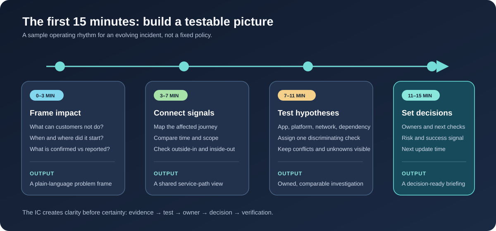
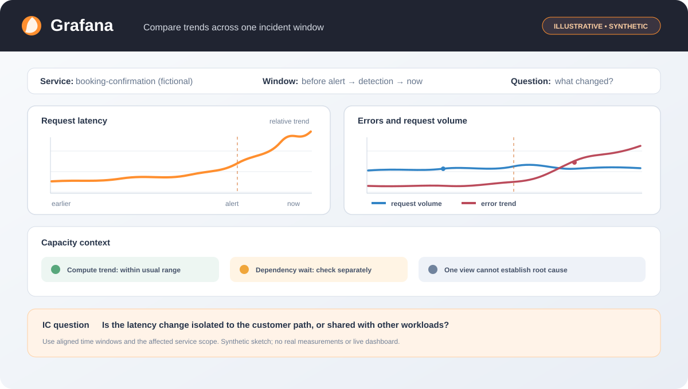
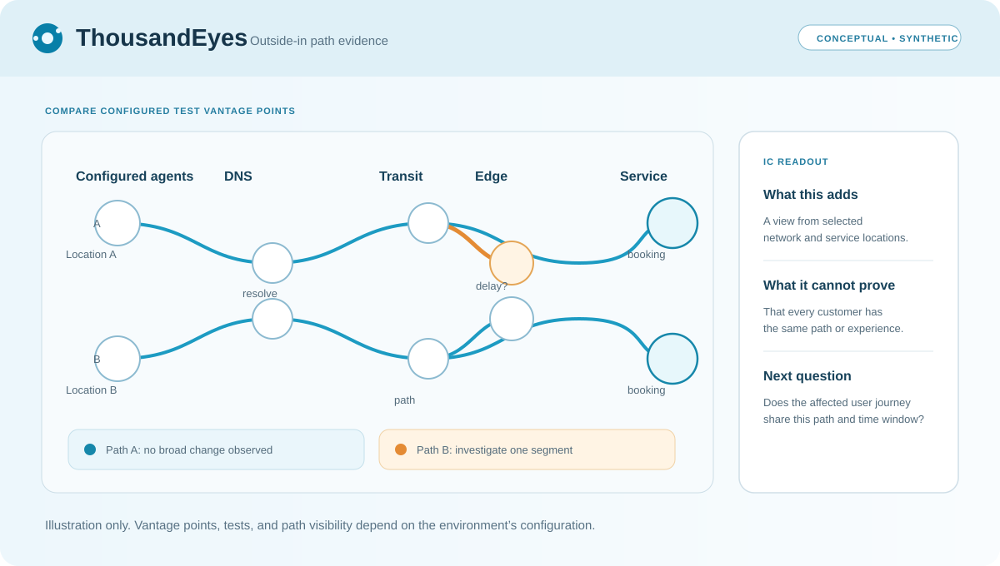
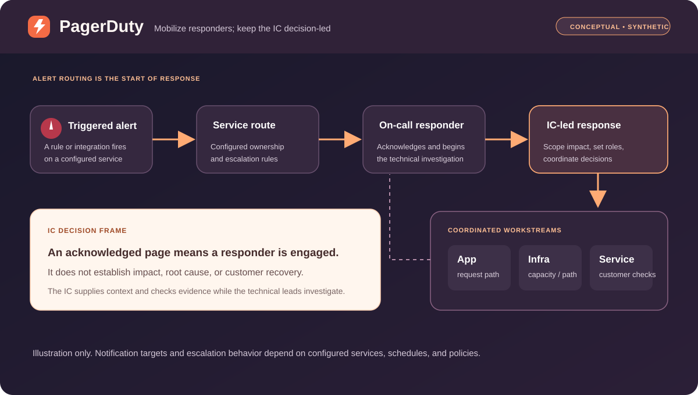
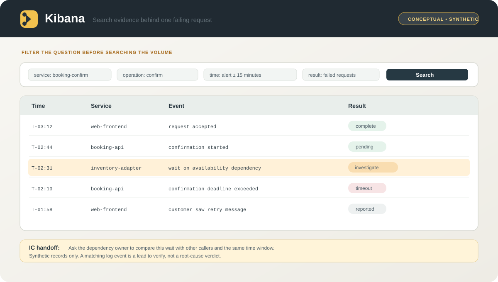

# The Incident Commander as Decision Architect

## The first 15 minutes: turning observability signals into a shared picture

*An incident commander does not need to know every technology better than the specialists. The IC needs to help the specialists turn evidence into timely, coordinated decisions.*

An alert fires. A customer-facing team reports failed transactions. One dashboard shows a spike, another looks normal, and the first responders are discussing different parts of the system.

This is where incident command can make a practical difference. The incident commander (IC) creates a shared picture from incomplete evidence: what customers are experiencing, what is confirmed, what is still uncertain, who is testing each possibility, and what result would change the response.

I think of the IC as a **decision architect**. The role is not to operate every dashboard or declare a root cause from the bridge. It is to shape the conditions for good decisions across application, infrastructure, network, dependency, and business teams.

## A useful rhythm for the first 15 minutes

The first minutes are not a race to name a root cause. They are a chance to agree on the problem, divide the investigation, and keep new evidence connected to customer impact. The timing below is an example rhythm, not a universal incident policy.

### Minutes 0–3: frame the customer problem

Start with the customer journey, not the component name.

- What can customers no longer do, or what has become slower or unreliable?
- When did the symptoms begin, and are they continuing?
- Which regions, customer groups, devices, or workflows appear affected?
- What is known from monitoring, and what is a report that still needs validation?

For example: “Some customers can browse available appointments but cannot confirm a booking. We have reports from two regions; total impact is not yet known.” That is more useful than “the booking API is broken” when the team has not established where the failure sits.

### Minutes 3–7: connect signals to the service path

An incident rarely respects organizational boundaries. Map the affected journey through the components and dependencies that could influence it. Check whether the change is isolated to one operation or appears across several services or locations.

Use observability as evidence with context:

- **Outside-in checks:** A ThousandEyes test can help examine reachability, DNS, network path, or application availability from configured vantage points. A result describes those test points and times; it does not automatically represent every customer.
- **Metrics and dashboards:** Grafana can help compare time-series signals and explore configured data sources. A chart is only as useful as its query, labels, time range, and freshness.
- **Logs and traces:** Kibana or OpenSearch Dashboards can help search events and inspect application or infrastructure detail, where that data is collected. High event volume can obscure the few records that explain the customer symptom.
- **Alerting and mobilization:** PagerDuty can route alerts through configured services and escalation policies. A page tells us that a rule fired; it does not, by itself, prove customer impact or identify the cause.

These products are examples of tool categories, not a claim that they are connected in one environment. Teams may use different products, data sources, retention, and access rules. [ThousandEyes test documentation](https://docs.thousandeyes.com/product-documentation/tests), [Grafana Explore](https://grafana.com/docs/grafana/latest/visualizations/explore/), [Kibana dashboards](https://www.elastic.co/docs/explore-analyze/dashboards), [OpenSearch observability](https://docs.opensearch.org/latest/observing-your-data/), and [PagerDuty incident overview](https://docs.pagerduty.com/incident-management/incidents/overview) describe example capabilities.

The next four diagrams are original, conceptual illustrations. They are not screenshots and do not imply that these products are integrated. Each view answers a different incident question.

### What each tool can—and cannot—tell the IC

| Example | Useful strength during an incident | Limitation to keep in view |
| --- | --- | --- |
| ThousandEyes | Adds an outside-in view of reachability, path, DNS, or application checks from configured test locations | Test locations and schedules are only a sample of customer experience; it does not explain every application failure |
| Grafana | Helps compare configured metrics, logs, or traces over time and across panels or data sources | A chart can be stale, aggregated, mis-scoped, or based on labels that hide the affected cohort |
| Kibana | Helps teams explore and visualize data collected in the Elastic environment, including logs and other observability signals | Search quality depends on ingestion, fields, permissions, retention, and the query’s scope |
| OpenSearch Dashboards | Can bring configured observability data into dashboards and investigation views | Missing instrumentation, delayed ingestion, or uneven coverage can leave blind spots |
| PagerDuty | Helps route triggered alerts and mobilize the configured responders | An alert or acknowledgement is not proof of root cause, customer impact, or recovery |

The IC uses each view for the question it can answer, checks the time range and scope, and looks for independent corroboration before treating a pattern as a conclusion.

### Minutes 7–11: test competing explanations

“Application or infrastructure?” is a useful starting question, but incidents often cross that boundary. A customer-facing application can fail because of its own code, a saturated compute layer, a network or DNS problem, or a dependency that is slow or unavailable. A shared infrastructure issue can also show up first as errors in one application journey.

Instead of assigning blame to a layer, ask each domain lead to test a hypothesis that would distinguish possibilities.

| Working hypothesis | Evidence to compare | A useful next check |
| --- | --- | --- |
| Application path or recent change | Errors and latency for the affected endpoint; traces for the failing request; timing against a deployment or configuration change | Can the team reproduce the failure on the affected path, and does the request fail before or after a dependency call? |
| Host, container, or platform capacity | Resource saturation, restarts, queue depth, and whether multiple workloads on the same platform are affected | Is the symptom shared by neighboring workloads or isolated to one service? |
| Network or DNS path | Reachability, name resolution, packet loss, path changes, and results from more than one vantage point | Does the same service behave differently across locations or paths? |
| Shared dependency | Connection waits, timeouts, error rates, and whether other callers to the dependency show the same symptom | Is the dependency slow for all callers, or only through one application path? |

Each signal has strengths and limitations. Outside-in tests help check the path a user may experience, but their coverage is bounded by their vantage points. Metrics make trends and comparisons visible, but a dashboard panel can be stale, aggregated, or scoped to the wrong cohort. Logs and traces add detail, but may be sampled, delayed, incomplete, or difficult to correlate. Paging tools help mobilize responders, but an alert’s priority is not a substitute for an impact assessment.

The IC does not need to settle the technical debate personally. The IC keeps the hypotheses explicit, assigns an owner and a next check to each, and asks what evidence would change the team’s current view.

### Minutes 11–15: turn the picture into decisions

By this point, the team should be able to explain the situation without overstating certainty:

1. **Customer impact:** what customers cannot do, where, and since when; include a range or state “unknown” when totals are not verified.
2. **Evidence:** the strongest signals, their sources and time windows, plus any evidence that conflicts.
3. **Current assessment:** the leading hypothesis and confidence, clearly marked as a hypothesis until confirmed.
4. **Workstreams:** named roles or teams, each with one next action and a time to report back.
5. **Decision point:** what result would justify a mitigation, escalation, or change in scope—and what risks come with that action.
6. **Next update:** when the team will reassess and communicate again.

This is the decision architecture: a visible link from customer impact to evidence, from evidence to a test, and from the test to an owner and decision.

## A fictional example across application and infrastructure

Imagine an online booking service where customers can search for an appointment but some requests fail during confirmation. A paging alert fires for the confirmation service. The service team sees elevated request errors. A dashboard shows host CPU within its usual range. A log search shows longer waits around a call to an availability dependency. Network tests from two configured locations do not show a broad reachability change, but they cannot rule out every client path.

The first useful statement is not “the network is fine” or “the dependency is the root cause.” The evidence supports a narrower view: the failure is concentrated on confirmation; the host metric checked so far does not show CPU pressure; and the dependency wait is a lead to investigate. The breadth of customer impact is still being established.

The IC can now divide the work:

- the application lead checks the failing request path and recent changes;
- the dependency owner compares latency and errors for other callers;
- the infrastructure or network lead checks the relevant platform and path signals;
- a customer or service representative validates whether the reported journey is still failing;
- the IC maintains the shared timeline, impact statement, decisions, and next update.

If a reversible mitigation is considered, the team agrees in advance on the expected signal and the risk. A reduction in errors after the change is evidence that the situation improved; it is not yet proof that every affected customer journey has recovered. The team retests the affected path, checks that improvement is sustained, and states what remains unverified.

The example is fictional and uses no production telemetry. It illustrates a way to reason across domains, not a diagnosis or a claim about any named product integration.

## Where AI can help an incident commander

AI is most useful when it reduces the effort of organizing evidence so people can spend more time interpreting it. With authorized inputs and appropriate safeguards, an assistant can help:

- assemble a source-linked timeline from incident updates;
- group similar symptoms and distinguish reports from measured signals;
- draft a service path or dependency map for human correction;
- summarize what changed, what is known, what conflicts, and what remains unknown;
- prepare a concise update and list the next questions to resolve;
- compare hypotheses and suggest a discriminating check for a domain lead to validate.

AI can also create new risks. It can turn an unverified report into a confident-sounding fact, miss contradictory evidence, repeat sensitive data, or suggest a plausible but unsupported cause. I would keep the source and time attached to each important claim, label hypotheses, use only authorized data, and require a person to approve operational decisions and external communications.

I would measure whether the workflow helps before claiming time or cost savings. Possible measures include time to a first evidence-backed briefing, corrections made during human review, whether important unknowns were surfaced, and whether recovery checks matched the affected customer journey.

## What makes the IC effective across many technologies

The IC does not win by having the deepest knowledge of every tower. The IC adds value by making expertise work together:

- **Translate:** connect service language to customer outcomes and back.
- **Separate:** label facts, reports, hypotheses, and unknowns.
- **Focus:** keep parallel workstreams small enough to make progress.
- **Challenge:** ask which evidence supports a conclusion and what could disprove it.
- **Decide:** make the decision owner, risk, and success signal clear.
- **Verify:** distinguish mitigation from sustained recovery.
- **Learn:** carry unanswered questions and follow-up actions into the review.

The first fifteen minutes will not always produce a root cause. They can produce something just as important: a shared, testable picture of impact and the next decisions the team needs to make.

That is the incident commander I am working to become: a leader who uses observability to connect the customer experience to technical evidence, brings teams together without pretending to be every specialist, and uses AI to reduce coordination friction while keeping judgment and accountability human.

---

*This article is an independent, provider-neutral learning piece. The scenario and diagrams are illustrative; the product names are examples of commonly used observability and incident-response categories. No production incident data or proprietary company procedures are included.*

### References

- [ThousandEyes: Tests](https://docs.thousandeyes.com/product-documentation/tests)
- [Grafana: Explore](https://grafana.com/docs/grafana/latest/visualizations/explore/)
- [Elastic: Kibana dashboards](https://www.elastic.co/docs/explore-analyze/dashboards)
- [OpenSearch: Observability](https://docs.opensearch.org/latest/observing-your-data/)
- [PagerDuty: Incidents overview](https://docs.pagerduty.com/incident-management/incidents/overview)
